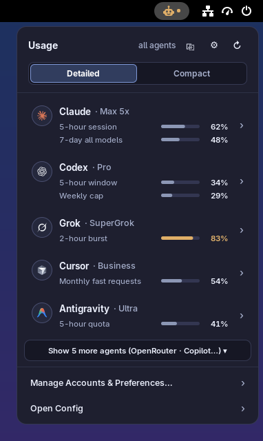
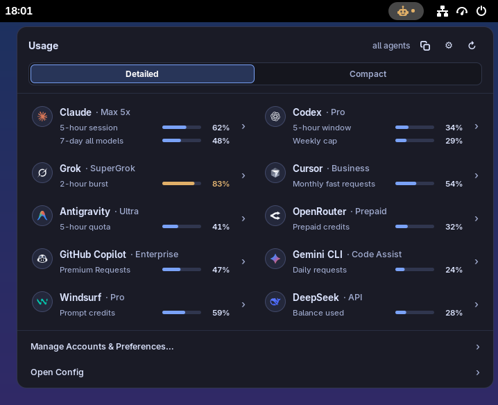
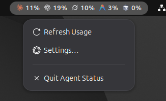
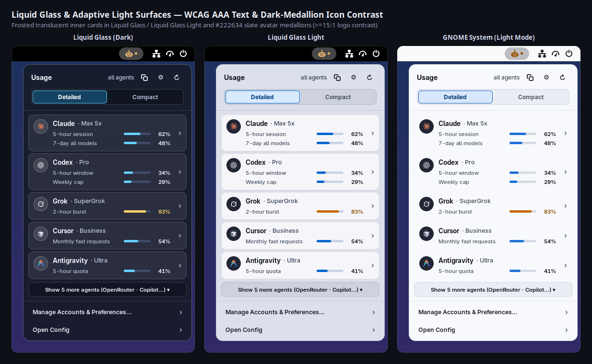
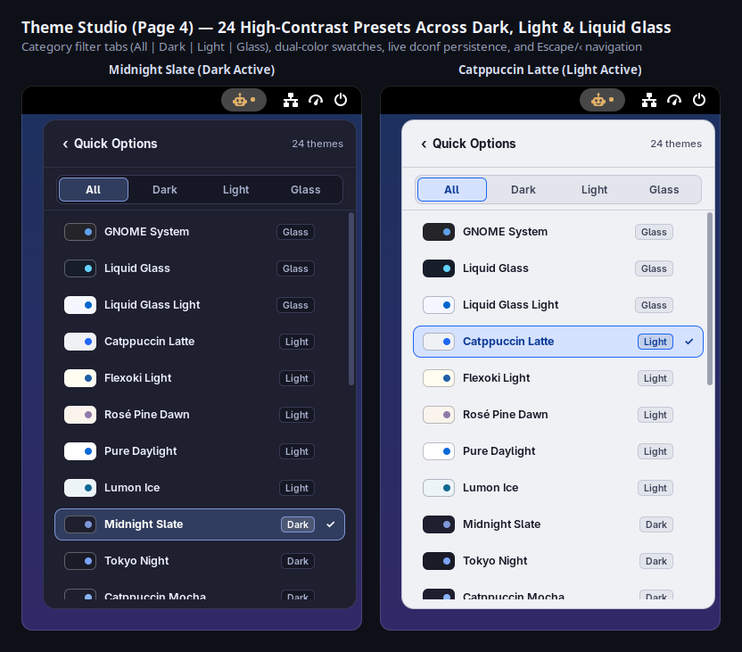
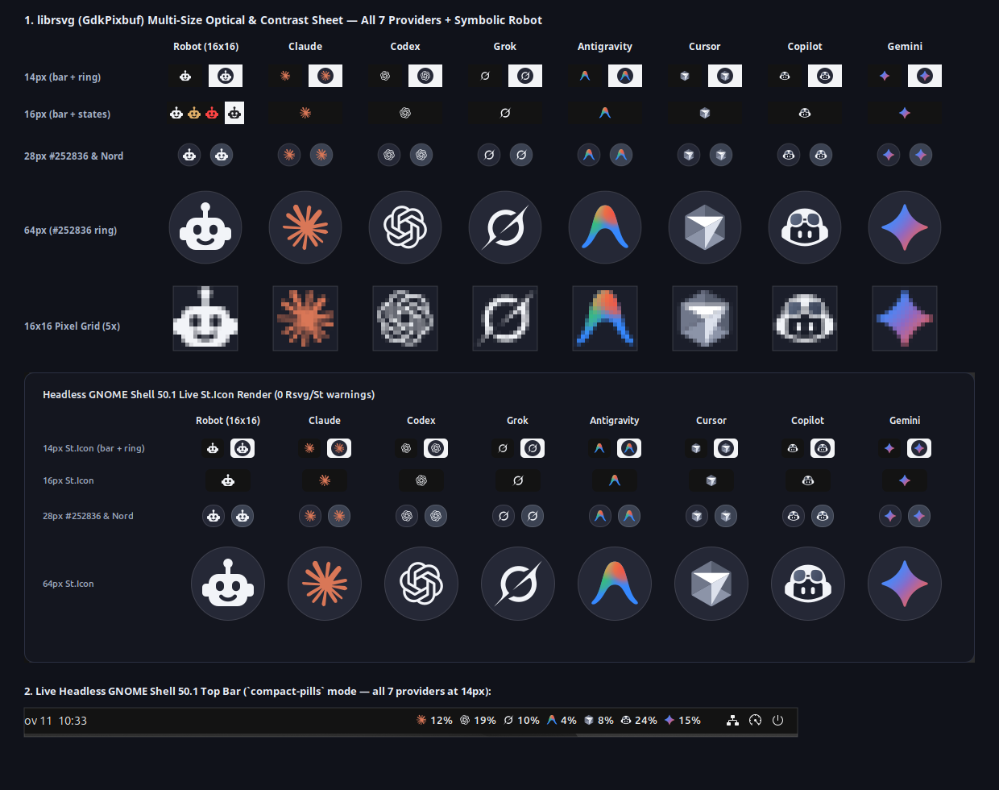

# gnome-agent-status

Track usage quotas, rolling session caps, 7-day burn trends, pace projections, reset countdowns, and multi-account status across **10 AI coding agent providers** from the GNOME Shell 45–50 top bar, Waybar, `tmux`, or any terminal.

<table>
  <tr>
    <td align="center" valign="top" width="44%">
      
      <br />
      <sub><b>Focused Top-5 Popover &amp; Progressive Disclosure</b> — Shows <i>Claude, Codex, Grok, Cursor, Antigravity</i> by default with 1-click copy summary and <i>Show N more agents</i>.</sub>
    </td>
    <td align="center" valign="top" width="56%">
      
      <br />
      <sub><b>2-Column Wide Bento Grid (<code>688px</code>)</b> — Side-by-side cards for all 10 providers across <i>Compact List</i>, <i>Auto 2-Column</i>, and <i>2-Column Wide</i> layouts.</sub>
      <br /><br />
      
      <br />
      <sub><b>Compact Top-Bar Pills &amp; Right-Click Menu</b> — Quick access to <i>Refresh Usage</i>, <i>Copy Usage Summary</i>, <i>Settings…</i>, and <i>Quit Agent Status</i>.</sub>
    </td>
  </tr>
  <tr>
    <td align="center" valign="top" colspan="2">
      
      <br />
      <sub><b>Frosted Liquid Glass &amp; Adaptive Light Surfaces</b> — <i>Liquid Glass</i>, <i>Liquid Glass Light</i>, and <i>GNOME System (Light Mode)</i> with frosted translucent cards, WCAG AAA primary text (<code>&gt;=10:1</code>), and <code>#222634</code> slate avatar medallions.</sub>
    </td>
  </tr>
  <tr>
    <td align="center" valign="top" colspan="2">
      
      <br />
      <sub><b>Dedicated Theme Studio (24 Presets)</b> — Filter across <code>All | Dark | Light | Glass</code> with WCAG-verified typography and dark-medallion icon contrast on light surfaces.</sub>
      <br /><br />
      
      <br />
      <sub><b>Pixel-Aligned Vector Iconography</b> — 16×16 symbolic robot with calm severity states alongside all 10 official 24×24 brand avatars on dark &amp; light medallions.</sub>
    </td>
  </tr>
</table>

See [SECURITY.md](SECURITY.md) for the security & threat model, [CONTRIBUTING.md](CONTRIBUTING.md) for architecture & contributor guidelines, and [CHANGELOG.md](CHANGELOG.md) for release notes.

---

## Highlights

### 10 Built-in AI Coding Providers

By default, the popover surfaces the **Top 5** providers (**Claude**, **Codex**, **Grok**, **Cursor**, **Antigravity**) in exact priority order to keep the primary view compact, while **OpenRouter**, **GitHub Copilot**, **Gemini CLI**, **Windsurf**, and **DeepSeek** are built in and ready to enable, reorder, or expand on demand:

1. **Claude (`claude` · `CC`)** — Weekly (`Weekly`), 5-hour session (`5-Hour`), model-specific buckets (`Sonnet`, `Opus`, `Fable`, etc.), and `Extra Usage` spend via passive `statusLine` hooks (`ingest-hook claude`), Anthropic OAuth usage API, or `claude -p /usage` CLI fallback (for SSO / `setup-token` profiles).
2. **Codex (`codex` · `CX`)** — 5-hour session (`5-Hour`), weekly (`Weekly`), additional limits, and credit balances via direct ChatGPT usage API, `codex app-server` JSON-RPC (`account/rateLimits/read`), or offline session rollout JSONL / zstd-compressed `.jsonl.zst` (`$CODEX_HOME/sessions/**/rollout-*.jsonl[.zst]`) fallback.
3. **Grok (`grok` · `GK`)** — Unified rolling weekly compute pool (`Weekly`) and on-demand / prepaid credit balances via the Grok CLI billing endpoint (with legacy ACP stdio fallback).
4. **Cursor (`cursor` · `CU`)** — Monthly cycle buckets (`Cursor Models`, `Other Models`, `Monthly`) and plan spend/badges (`Pro`, `Business`, `Ultra`) via embedded `rusqlite` (`mode=ro&immutable=1` non-locking read-only access — zero external `sqlite3` CLI dependency) plus Electron `safeStorage` (`v10` and Linux `v11`) in-memory decryption, JSON token file, or `CURSOR_ACCESS_TOKEN`.
5. **Antigravity (`agy` · `AG`)** — All 4 model-family quotas (`Gemini · Weekly`, `Gemini · 5-Hour`, `Claude & GPT · Weekly`, `Claude & GPT · 5-Hour`), combining Antigravity 2.0 Linux `daemon/hub_<port>.json` & `/proc` local `language_server` Connect-RPC (`GetUserStatus` in `<2ms`) when the IDE is open with `agy -p /usage --output-format json`.
6. **OpenRouter (`openrouter` · `OR`)** — Daily/weekly/monthly key limits (`GET /api/v1/key`), prepaid credit pools (`GET /api/v1/credits`), or pay-as-you-go spend tracking via `$OPENROUTER_API_KEY` or `~/.config/openrouter/{api_key,config.json,auth.json}`.
7. **GitHub Copilot (`copilot` · `CP`)** — Monthly `Premium Requests` (`31d`) plus metered `Chat` / `Completions` quotas and plan badges (`Free`, `Pro`, `Pro+`, `Business`, `Enterprise`) via `copilot_internal/user`, reading `GITHUB_COPILOT_TOKEN`, `~/.config/github-copilot/{hosts,apps}.json`, or `~/.config/gh/hosts.yml` (silently omitted when `gh` has no active Copilot plan).
8. **Gemini CLI (`gemini` · `GM`)** — Daily model-group quotas (`Gemini Pro · Daily`, `Gemini Flash · Daily`) via Cloud Code `v1internal:retrieveUserQuota`, inspecting `~/.gemini/oauth_creds.json`, `~/.gemini-*/oauth_creds.json`, or `GEMINI_CLI_OAUTH_TOKEN` strictly read-only.
9. **Windsurf (`windsurf` · `WS`)** — Prompt & flow action credit buckets and plan tiers via local Linux `/proc` `language_server_linux` Connect-RPC (`exa.language_server_pb.LanguageServerService/GetUserStatus`, disambiguated from Antigravity) with non-locking read-only `rusqlite` (`immutable=1` + `PRAGMA query_only = ON`) fallback on `~/.config/Windsurf/User/globalStorage/state.vscdb`.
10. **DeepSeek (`deepseek` · `DS`)** — Prepaid & topped-up API credit balance tracking (`USD` preferred, `CNY` fallback, depletion alerts) via `GET https://api.deepseek.com/user/balance` using `$DEEPSEEK_API_KEY` or `~/.config/deepseek/{api_key,config.json,auth.json}`.

### Calm, Flexible GNOME Shell 45–50 Experience

- **Progressive Disclosure & 2-Column Wide Bento Grid**:
  - **In-Place Overflow Toggle** — Additional active providers collapse cleanly behind **`Show N more agents (…) ▾`** / **`Show fewer ▴`**, automatically surfacing a semantic warning/critical dot (and auto-expanding) whenever a collapsed provider crosses `80%`.
  - **Three Popover Layouts (`popover-layout`)** — Switch instantaneously in Quick Options or Preferences between **Compact List** (`352px` single column), **Auto 2-Column** (widens automatically when 6+ providers are visible on monitors `>=760px`), and **2-Column Wide** (`688px` side-by-side Bento grid).
- **24 High-Contrast Themes & Dedicated Theme Studio**:
  - **Glass & Adaptive (`3`)** — **GNOME System** (`system` — adapts dynamically to dark `#242429` and light `#f8f9fc` shell styles), Apple-inspired **Liquid Glass** (`liquid-glass`), and **Liquid Glass Light** (`liquid-glass-light`) with frosted translucent cards.
  - **Light Palettes (`5`)** — **Catppuccin Latte** (`catppuccin-latte`), **Flexoki Light** (`flexoki-light`), **Rosé Pine Dawn** (`rose-pine-dawn`), **Pure Daylight** (`daylight-white`), and **Lumon Ice** (`lumon`), using `#222634` dark-slate avatar medallions (`>=15:1` white-logo contrast).
  - **Dark Developer Palettes (`16`)** — **Midnight Slate** (`midnight-slate`, default), **Tokyo Night** (`tokyo-night`), **Catppuccin Mocha** (`catppuccin`), **Everforest** (`everforest`), **Gruvbox** (`gruvbox`), **Kanagawa** (`kanagawa`), **Matte Black** (`matte-black`), **Nord** (`nord`), **Osaka Jade** (`osaka-jade`), **Ristretto** (`ristretto`), **Rosé Pine** (`rose-pine`), **Ethereal** (`ethereal`), **Hackerman** (`hackerman`), **Miasma** (`miasma`), **Vantablack** (`vantablack`), and **Retro 82** (`retro-82`).
  - **WCAG Contrast Verified** — Automated tests enforce `>=10.0:1` primary text, `>=5.8:1` secondary text, and `>=5.5:1` active pill contrast across every preset, browsable live in the dedicated **Theme Studio** (`All | Dark | Light | Glass` filter tabs, `Escape` / `BackSpace` / `‹ Quick Options` navigation).
- **7-Day Burn Sparkline & Pace Projections**:
  - **7-Day Trend Sparkline** — Quantized hourly ring buffer (`168` samples over 7 days in `collector-cache.json`) rendered via a live Cairo `SparklineChart` inside each provider's drill-down Hero Card.
  - **Burn-Rate / Pace Indicator** — Computes live sustainable quota pacing (`Pace: Comfortable`, `Pace: On track · ~88% by reset`, `Pace: 1.9× sustainable · hits 100% before reset`) from window duration and remaining reset time.
- **1-Click Copy Usage Summary & Global Keyboard Shortcut**:
  - **Copy Usage Summary** — Click the symbolic copy button (`edit-copy-symbolic`) in the popover header (with instant check confirmation) or choose **Copy Usage Summary** from the top-bar right-click menu to copy a clean, secret-free multi-agent summary to the clipboard.
  - **Global Toggle Shortcut (`keybinding-toggle-popover`)** — Bind `<Super><Shift>A` (or any custom accelerator via the GTK4 shortcut capture dialog in Preferences) to open/close the usage popover from anywhere.
- **Smart Notifications & Zero-Daemon Auto-Refresh**:
  - Deduplicated per-window `80%` (*Warning*), `90%` (*Critical*), and *Quota Reset* desktop notifications, plus automatic refreshes on system wake (`PrepareForSleep`), network reconnect (`Gio.NetworkMonitor`), and credential sign-in (`Gio.FileMonitor`).

---

## Installation & Lifecycle

### Prerequisites

- **Rust toolchain** (`cargo` and `rustc`, stable)
- **GNOME Shell 45–50** *(required for the top-bar extension; the `gnome-agent-status` CLI runs standalone on Linux and macOS, including Waybar/`tmux`/Sway/Hyprland/SSH environments)*
- **`glib-compile-schemas`** *(provided by `libglib2.0-bin`, `glib2`, or `glib2-devel`)*

*(SQLite and TLS are compiled directly into the binary via bundled `rusqlite` and `rustls`, so no external `sqlite3` or OpenSSL system libraries are needed.)*

### Build & Install

```bash
# Standard install (CLI binary, completions, manpage, systemd units, and GNOME Shell extension)
./install.sh

# Optional: also enable & start the systemd --user background timer (for Waybar / Sway / Hyprland / tmux)
./install.sh --enable-timer
```

`./install.sh` performs:

1. Compiles `gnome-agent-status` (`cargo build --release`) and installs it to `~/.local/bin/gnome-agent-status`.
2. Initializes `~/.config/gnome-agent-status/config.toml` (`0600`) if not already present.
3. Installs shell completions (`bash`, `zsh`, `fish`) and the `gnome-agent-status(1)` manual page under `~/.local/share/`.
4. Installs hardened `gnome-agent-status.{service,timer}` user units to `~/.config/systemd/user/` (enabled only when `--enable-timer` is passed or manually enabled).
5. Installs `extension/` (`popover/`, `icons/`, `schemas/`, `locale/`, `prefs.js`, `stylesheet.css`, `metadata.json`) to `~/.local/share/gnome-shell/extensions/agent-status@gnome-agent-status/`, compiles GSettings schemas with `--strict`, and enables the extension.

> **Wayland note:** When installing a GNOME Shell extension for the first time on a Wayland session, log out and log back in once so GNOME Shell discovers the new extension directory.

### Optional `systemd --user` Timer (Waybar / `tmux` / Tiling WMs)

Inside GNOME Shell, the extension triggers background refreshes automatically without a resident daemon. On standalone compositors (Sway, Hyprland, Niri, cosmic, SSH), enable the user timer so `gnome-agent-status cached --waybar` / `cached --tmux` always reads fresh `<2ms` snapshots:

```bash
systemctl --user enable --now gnome-agent-status.timer
systemctl --user list-timers gnome-agent-status.timer
```

### Shell Completions & Manual Page

`./install.sh` installs completions and `man 1 gnome-agent-status` automatically. You can also generate them directly:

```bash
gnome-agent-status completions bash > ~/.local/share/bash-completion/completions/gnome-agent-status
gnome-agent-status completions zsh  > ~/.local/share/zsh/site-functions/_gnome-agent-status
gnome-agent-status completions fish > ~/.config/fish/completions/gnome-agent-status.fish
gnome-agent-status manpage          > ~/.local/share/man/man1/gnome-agent-status.1
```

### Uninstall

```bash
# Remove extension, CLI, completions, manpage, and systemd units (preserving config & cache)
./uninstall.sh

# Remove everything including ~/.config/gnome-agent-status and ~/.cache/gnome-agent-status
./uninstall.sh --purge
```

### Preferences Window (Libadwaita)

```bash
gnome-extensions prefs agent-status@gnome-agent-status
```

Preferences organizes settings across three searchable pages:

1. **Appearance & Top Bar** — Panel mode (`Minimal Icon`, `Compact Pills`, `Full Text`), panel box (`Left`, `Center`, `Right`) & index, `Auto-Hide When Empty`, **Global Toggle Shortcut** (`<Super><Shift>A` one-click preset, modal GTK4 key capture, or Clear), **Theme** (all 24 presets synced live with the popover), **Popover Layout** (`Compact List`, `Auto 2-Column`, `2-Column Wide`), density (`Detailed` / `Compact`), typography (`System Tabular` / `Monospace`), and metric (`% Used` / `% Remaining`).
2. **Refresh & Visibility** — Background refresh interval (`300s` default), `auto_discover` toggle, collector timeout, custom binary path, **Desktop Notifications** (`80%` warning, `90%` critical, quota reset), and unified **Visible Agents & Display Order** (per-agent switches, Up/Down ordering, and **Reset to Default Top 5**).
3. **Accounts & Manual Locations** — View, add, edit, or remove custom account directories, API key files, or SQLite databases in `config.toml` using native GTK4 file/folder pickers.

---

## Provider Discovery & Multi-Account Setup

### Automatic Discovery (`auto_discover = true`)

By default, `gnome-agent-status` inspects local credential locations in **strictly read-only** mode and deduplicates matching accounts across profile slots:

| Order | ID | Code | Provider | Auto-Discovered Sources & Fallbacks | Default Visibility |
| :---: | :--- | :---: | :--- | :--- | :---: |
| 1 | `claude` | `CC` | **Claude** | `~/.claude`, `~/.claude-*` (`.credentials.json` + `.claude.json`); passive `ingest-hook claude`; `claude -p /usage` SSO fallback | Shown (Top 5) |
| 2 | `codex` | `CX` | **Codex** | `~/.codex`, `~/.codex-*` (`auth.json`), `codex app-server`, `$CODEX_HOME/sessions/**/rollout-*.jsonl[.zst]`, `~/.local/share/opencode/auth.json` | Shown (Top 5) |
| 3 | `grok` | `GK` | **Grok** | `~/.grok`, `~/.grok-*`, `~/.grok-swap/accounts/*` (`auth.json`), or `$GROK_OAUTH_TOKEN` | Shown (Top 5) |
| 4 | `cursor` | `CU` | **Cursor** | Read-only `rusqlite` (`immutable=1`) on `~/.config/Cursor/User/globalStorage/state.vscdb`, Electron `safeStorage` (`v10`/`v11`), JSON token file, or `$CURSOR_ACCESS_TOKEN` | Shown (Top 5) |
| 5 | `agy` | `AG` | **Antigravity** | Antigravity 2.0 `daemon/hub_<port>.json` & `/proc` local `language_server` Connect-RPC (`<2ms`) + `agy -p /usage --output-format json` | Shown (Top 5) |
| 6 | `openrouter` | `OR` | **OpenRouter** | `$OPENROUTER_API_KEY` or `~/.config/openrouter/{api_key,config.json,auth.json}` querying `GET /api/v1/key` & `/api/v1/credits` | Hidden (1-click enable) |
| 7 | `copilot` | `CP` | **GitHub Copilot** | `$GITHUB_COPILOT_TOKEN`, `~/.config/github-copilot/{hosts,apps}.json`, or `~/.config/gh/hosts.yml` (`gh auth token` keyring fallback) | Hidden (1-click enable) |
| 8 | `gemini` | `GM` | **Gemini CLI** | `~/.gemini/oauth_creds.json`, `~/.gemini-*/oauth_creds.json`, or `$GEMINI_CLI_OAUTH_TOKEN` querying `v1internal:retrieveUserQuota` | Hidden (1-click enable) |
| 9 | `windsurf` | `WS` | **Windsurf** | Linux `/proc` `language_server_linux` (`windsurf` / `.codeium/windsurf`) Connect-RPC `GetUserStatus` + read-only `rusqlite` `state.vscdb` fallback | Hidden (1-click enable) |
| 10 | `deepseek` | `DS` | **DeepSeek** | `$DEEPSEEK_API_KEY` or `~/.config/deepseek/{api_key,config.json,auth.json}` querying `GET /user/balance` (`USD`/`CNY`) | Hidden (1-click enable) |

### Adding Manual Account Locations

```bash
# Add an isolated work Claude profile polled actively
gnome-agent-status config upsert-account \
  --provider claude \
  --id work \
  --label "Work Claude" \
  --path ~/.claude-work \
  --poll-mode active

# Add an OpenRouter or DeepSeek API key file (chmod 600)
gnome-agent-status config upsert-account \
  --provider openrouter \
  --id team \
  --label "Team Router" \
  --path ~/.config/openrouter/api_key

# Remove a manual account entry
gnome-agent-status config remove-account --provider claude --id work
```

See [`config.example.toml`](config.example.toml) for a complete 10-provider configuration template (v0.1 `[[agents]]` entries remain 100% backwards-compatible).

### Optional: Claude Code `statusLine` Passive Hook (`0` API Calls)

Feed Claude Code's live `statusLine` JSON into `gnome-agent-status ingest-hook claude` to update `state.json`, 7-day sparklines, and the GNOME top bar in `<2ms` with **zero** background HTTP polling:

```json
{
  "statusLine": {
    "type": "command",
    "command": "gnome-agent-status ingest-hook claude"
  }
}
```

---

## Waybar & `tmux` Status Bar Integration

Both live collection (`gnome-agent-status`) and zero-network cache reads (`gnome-agent-status cached`, `<2ms`) emit compact short codes (`CC`, `CX`, `GK`, `CU`, `AG`, `OR`, `CP`, `GM`, `WS`, `DS`) via `--waybar` and `--tmux`.

### Waybar (`--waybar`)

```jsonc
"custom/agent-status": {
  "exec": "~/.local/bin/gnome-agent-status cached --waybar",
  "return-type": "json",
  "interval": 30,
  "on-click": "~/.local/bin/gnome-agent-status collect --force >/dev/null",
  "tooltip": true
}
```

### `tmux` (`--tmux`)

```tmux
set -g status-interval 60
set -g status-right-length 120
set -g status-right "#(~/.local/bin/gnome-agent-status cached --tmux) #[fg=brightblack]|#[default] %H:%M"
```

---

## CLI Reference & `doctor` Diagnostics

All commands accept `--config <path>` to override `$XDG_CONFIG_HOME/gnome-agent-status/config.toml`.

```bash
# Run zero-secret health, permission (0600/0700), schema, and 10-provider discovery diagnostics
gnome-agent-status doctor
gnome-agent-status doctor --json

# Collect (respecting per-account TTL & HTTP 429 backoff), update state.json, print JSON
gnome-agent-status [--pretty]

# Print aligned terminal table (optionally with ANSI severity colors)
gnome-agent-status --text [--color]

# Read cached snapshot with live reset time-decay & 7-day sparklines in <2ms (zero network I/O)
gnome-agent-status cached [--pretty | --waybar | --tmux]
```

| Subcommand | Description |
| :--- | :--- |
| `gnome-agent-status collect [--force] [--provider <id>] [--pretty]` | Refresh expired accounts, update 7-day hourly sparklines, atomically write `state.json`, and print `StatusReport` v2 JSON. `--force` honors a `30s` manual debounce and HTTP `429` `retry_after` locks. |
| `gnome-agent-status cached [--pretty \| --waybar \| --tmux]` | Read `state.json` / `collector-cache.json`, apply passive reset time-decay (`now >= resets_at_epoch => 0% used`), and print output in `<2ms` with zero network or subprocess I/O. |
| `gnome-agent-status doctor [--json]` | Inspect binary/OS metadata, `config.toml` syntax & `0600` permissions, cache directory (`0700`) & cache files (`0600`), GNOME extension & `gschemas.compiled`, and 10-provider discovery counts with **zero** secret or email leakage. |
| `gnome-agent-status account select <provider_id> <account_id>` | Pin `<account_id>` (or `"default"`) as active for `<provider_id>`, run optional `switch_command`, update `state.json`, and print updated `StatusReport` v2 JSON. |
| `gnome-agent-status config show \| set \| upsert-account \| remove-account` | Inspect or safely edit `config.toml` while preserving user comments via `toml_edit`. |
| `gnome-agent-status ingest-hook claude [--account <id>]` | Read Claude Code `statusLine` JSON from `stdin` and atomically update passive `5h` / `wk` buckets and sparklines. |
| `gnome-agent-status completions <bash\|zsh\|fish\|elvish\|powershell>` | Generate shell completion script to `stdout`. |
| `gnome-agent-status manpage` | Render ROFF manual page (`gnome-agent-status(1)`) to `stdout`. |

---

## Security & Supply-Chain Posture

See [**SECURITY.md**](SECURITY.md) for the complete threat model and vulnerability reporting policy:

- **Zero Secrets or Emails in Cache / Diagnostics**: `state.json`, `collector-cache.json`, clipboard summaries, and `doctor` output never write OAuth access/refresh tokens, API keys (`sk-ant-*`, `sk-or-v1-*`, `sk-ws-*`, `sk-*`), JWTs, cookies, or `--csrf_token` values, and `doctor` additionally strips email addresses (`sanitize_zero_pii`).
- **Strict `https://` Non-Loopback Transport Guard**: Pure-Rust `ureq` + `rustls` validates every request URL before opening a socket — remote hosts MUST use `https://`, while `http://` is restricted strictly to loopback (`127.0.0.1`, `localhost`, `::1`, `[::1]`) for local IDE Connect-RPC, with a hard `2 MiB` response cap.
- **`O_NOFOLLOW` + `0600` / `0700` Atomic Writes**: Directories are enforced at `0700` and files (`state.json`, `collector-cache.json`, `config.toml`, temp SQLite WAL copies) use `create_new(true)` + `O_NOFOLLOW` mode `0600` temp files, `flock` serialization, and atomic `rename()`.
- **Read-Only Credential & SQLite Access**: Cursor and Windsurf `state.vscdb` databases are opened with `mode=ro&immutable=1` + `PRAGMA query_only = ON` via embedded `rusqlite`; OAuth refresh tokens are never rotated behind provider CLIs' backs; and GNOME Shell's GJS layer never reads credential file contents.
- **Kernel-Backed Subprocess Reaping**: Child CLI processes run in isolated Unix process groups (`process_group(0)`) with Linux `PR_SET_PDEATHSIG(SIGKILL)` and `kill(-pgid, SIGKILL)` timeout reaping.
- **Audited Supply Chain (`cargo-audit` + `cargo-deny`)**: Continuous enforcement via [`deny.toml`](deny.toml) checks RustSec advisories, OSI-approved licenses, crate bans (OpenSSL denied in favor of pure-Rust `rustls`), and trusted registry sources, paired with SLSA build provenance attestations in [`.github/workflows/release.yml`](.github/workflows/release.yml).

---

## Packaging & Developer Verification

See [CONTRIBUTING.md](CONTRIBUTING.md) for the full repository layout, GNOME Shell 45–50 & GTK4 process-boundary rules, and step-by-step guides for adding providers or WCAG-verified theme presets.

```bash
# Run all 8 static guardrails (process boundaries, motion comfort, ClickGesture, JS/bash syntax, schema, secrets, brand hygiene)
./scripts/check-guardrails.sh

# Run pure-JS unit & 24-theme WCAG contrast tests (Node 22+ built-in test runner)
node --test tests/*.test.mjs

# Run Rust linter, 94-test hermetic suite, RustSec advisory audit, and cargo-deny policy check
cargo clippy --locked --all-targets -- -D warnings
cargo test --locked
cargo audit
cargo deny check

# Build and verify an extensions.gnome.org (EGO) .shell-extension.zip bundle
./scripts/pack-extension.sh
# Output: ./target/extension-dist/agent-status@gnome-agent-status.shell-extension.zip
```

## License & Changelog

- **Contributing**: [CONTRIBUTING.md](CONTRIBUTING.md)
- **Changelog**: [CHANGELOG.md](CHANGELOG.md)
- **Security Policy**: [SECURITY.md](SECURITY.md)
- **License**: Apache License 2.0 — see [LICENSE](LICENSE).
